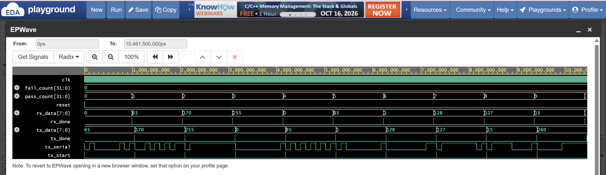

# 8-Bit UART Transmitter & Receiver | Verilog

An 8-bit UART communication system designed in Verilog HDL using finite-state machines (FSMs). Features 8N1 serial communication, automated loopback verification, and waveform analysis.

## Features
- 8-bit UART transmitter and receiver
- FSM-based design (IDLE, START, DATA, STOP)
- 8N1 serial communication
- Automated Verilog testbench
- Waveform visualization using EPWave

## Technologies
Verilog HDL | Icarus Verilog | EDA Playground | EPWave

## Simulation Results
- **Total Tests:** 10
- **Passed:** 10
- **Failed:** 0
- **Overall Status:** PASS

All 10 test cases successfully verified UART data transmission and reception.

## Simulation Waveform

## Project Files
- `uart_tx.v` — UART transmitter
- `uart_rx.v` — UART receiver
- `uart_tb.v` — Automated verification testbench
- `uart_waveform.png` — Simulation waveform

## How to Run
1. Open EDA Playground.
2. Select Icarus Verilog as the simulator.
3. Load the transmitter, receiver, and testbench files.
4. Run the simulation and view the results in EPWave.
